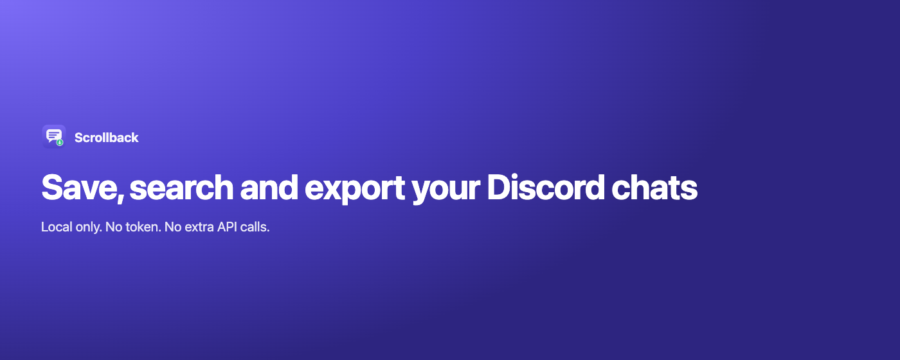
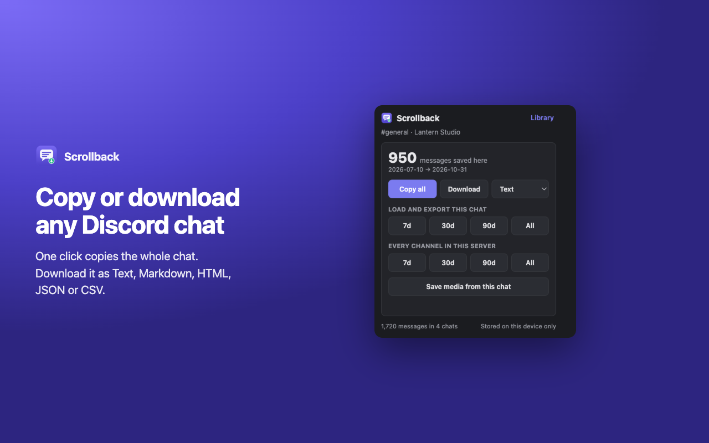
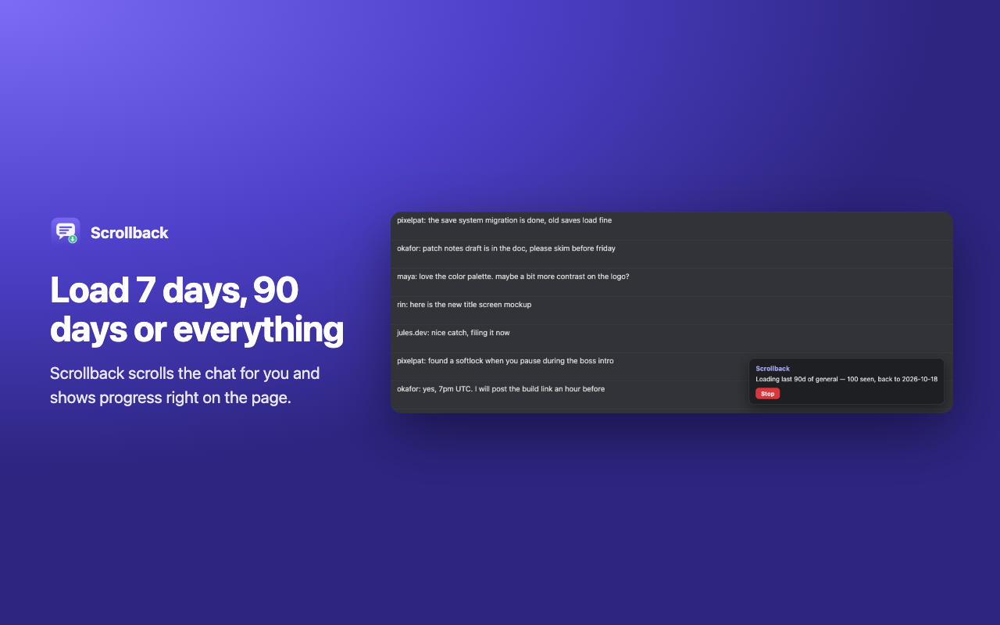
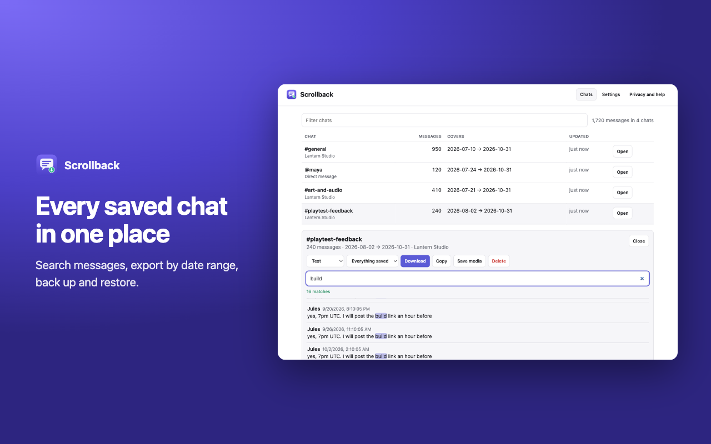
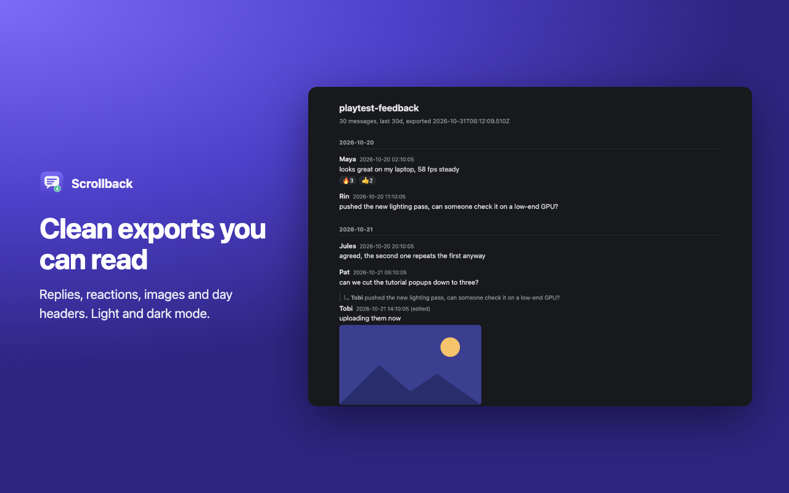
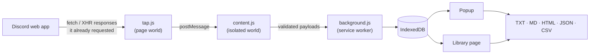

<p align="center">
  
</p>

<h1 align="center">Scrollback</h1>

<p align="center">
  <b>Save, search and export the Discord chats you can already see.</b><br>
  Local only. No token. No extra API calls.
</p>

<p align="center">
  <a href="https://github.com/crrapi/scrollback/actions/workflows/test.yml"></a>
  
  
  <a href="LICENSE"></a>
</p>

<p align="center">
  <a href="#install">Install</a> ·
  <a href="#how-it-works">How it works</a> ·
  <a href="#privacy">Privacy</a> ·
  <a href="#develop">Develop</a> ·
  <a href="https://crrapi.xyz/scrollback/privacy/">Privacy policy</a>
</p>

---

Scrollback is a Chrome extension that keeps a copy of every Discord message your browser loads. Copy a whole chat in one click, export it to five formats, or let it scroll back through 7 days, 90 days or the full history for you.

It never touches your login token and never calls Discord's API. It reads only the responses the Discord web app already downloads, so it acts the same as you scrolling by hand.

<table>
  <tr>
    <td width="50%"></td>
    <td width="50%"></td>
  </tr>
  <tr>
    <td width="50%"></td>
    <td width="50%"></td>
  </tr>
</table>

## Features

| | |
|---|---|
| **One-click copy** | The whole chat on your clipboard, ready for notes or an AI assistant |
| **Five export formats** | Text, Markdown, HTML (inline images, dark mode), JSON, CSV (formula-safe) |
| **History jobs** | Load the last 7, 30 or 90 days or everything. Progress shows on the page, with a Stop button |
| **Whole server** | Export every text channel in a server into one file |
| **Full context** | Replies, edits, embeds, stickers, reactions and who reacted |
| **Media** | Save a chat's images and videos into `Downloads/Scrollback/<chat>/` |
| **Library** | Browse and search every saved chat, export by date range, delete one or all |
| **Backup** | Back up everything to one JSON file and restore it on another machine |

## Install

**Chrome Web Store:** in review. The link will go here once it is approved.

**From source:**

1. Download this repo (Code → Download ZIP) and unzip it, or `git clone https://github.com/crrapi/scrollback`.
2. Open `chrome://extensions` and turn on **Developer mode**.
3. Click **Load unpacked** and pick the folder.
4. Reload any Discord tab you already had open.

Works on `discord.com`, `ptb.discord.com` and `canary.discord.com` in Chrome 111+ and other Chromium browsers. It does not work in the Discord desktop app.

## Use it

1. Open a channel or DM on discord.com and scroll as usual. Scrollback saves every message Discord loads.
2. Click the toolbar icon. **Copy all** or **Download** exports what is saved.
3. Click **7d**, **30d**, **90d** or **All** to have Scrollback scroll back for you. The file downloads when the job ends.
4. Open **Library** for every saved chat, search, date ranges, backups and settings.

## How it works



- **`src/tap.js`** runs in the page and wraps `fetch` and `XMLHttpRequest` read-only. It clones only the response bodies of message, search and reaction-list endpoints. It never looks at requests or headers.
- **`src/content.js`** relays captures, reports the channel and server name, and runs history jobs by scrolling the real message list. Server jobs click through the sidebar one channel at a time.
- **`src/background.js`** validates and trims every message before it hits storage, renders exports, and saves media only when you ask.
- **`src/db.js`** is the IndexedDB store, shared by the service worker and the library page.
- **`src/format.js`** has the snowflake math and all five exporters.

## Privacy

- No server, no account, no analytics, no remote code.
- No token, cookies or request headers are read.
- No network requests of its own. Media you choose to save downloads from Discord's own CDN.
- Data stays in your browser profile until you delete it. Removing the extension deletes it too.

Full policy: [crrapi.xyz/scrollback/privacy](https://crrapi.xyz/scrollback/privacy/). Found a hole? See [SECURITY.md](SECURITY.md).

## Develop

```bash
npm install
npx playwright install chromium
```

```bash
npm test
```

```bash
npm run test:e2e
```

```bash
npm run build
```

`npm test` runs the exporter unit tests. `npm run test:e2e` loads the extension in Chromium against a fake Discord client and checks capture, 30-day and full-history jobs, the server job, media saving, v1 migration, backup and restore, the library and the popup. `npm run build` writes the store zip and an upload kit to `dist/`. `npm run shots` regenerates the store screenshots from the real UI.

When you bump the version, change `manifest.json`, `package.json` and `VERSION` in `src/format.js` together. See [CONTRIBUTING.md](CONTRIBUTING.md).

## Known limits

- Messages that arrive live through Discord's gateway are saved the next time Discord fetches that chat.
- Edits and deletions after a message was saved show up only when Discord loads it again.
- Discord attachment links expire after about 24 hours, so save media soon after loading a chat.

## Disclaimer

Only export chats you have the right to keep. Respect the people in them, the rules of each server, and Discord's Terms of Service. Scrollback is not affiliated with or endorsed by Discord Inc.

## License

[MIT](LICENSE)
